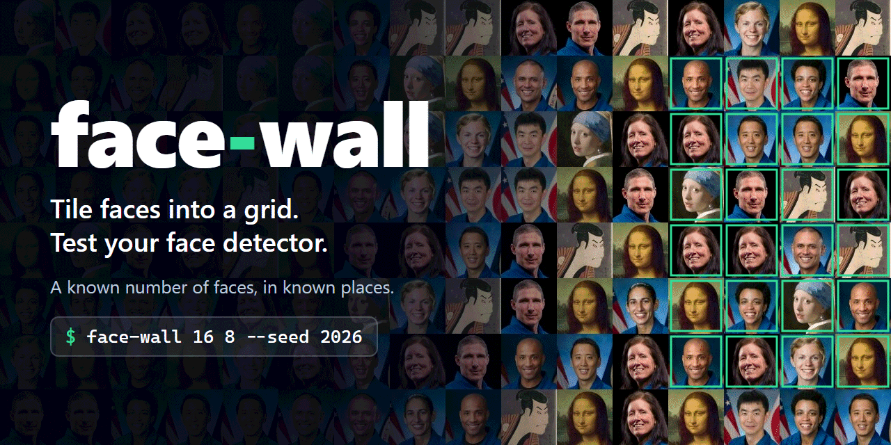
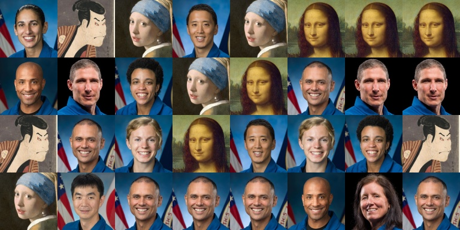
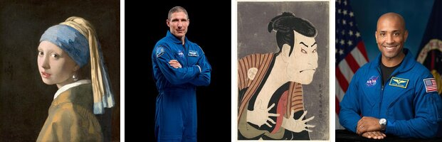
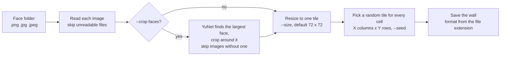

<p align="center">
  
</p>

# Face Wall Generator Tool

[](https://github.com/NatLee/face-wall-generator-tool/actions/workflows/ci.yml)


[](LICENSE)

Need a test image with lots of faces in it? `face-wall` takes a folder of face pictures and tiles
them into an X-by-Y grid, picking a face at random for every cell. You get one image with a known
number of faces at known positions, which is exactly what you want when you check a face detection
or recognition model: run the model, compare what it found with the grid. If your pictures are
ordinary photos rather than face crops, `--crop-faces` cuts each one down to the face first, using
the small YuNet detector that runs inside OpenCV.



<sub>`face-wall 8 4 docs/images/sample-wall.jpg --seed 1 --size 96`, made from the sample faces
in [`faces/`](faces/). They are public-domain NASA portraits and paintings; see
[CREDITS.md](CREDITS.md).</sub>

## Install

You need Python 3.9 or newer.

```bash
pip install git+https://github.com/NatLee/face-wall-generator-tool
```

Or work from a clone, which also gives you the sample faces to play with:

```bash
git clone https://github.com/NatLee/face-wall-generator-tool
cd face-wall-generator-tool
pip install -e .
```

The only dependencies are NumPy and `opencv-python-headless` (OpenCV without the desktop GUI
parts, so it also works in containers and on servers).

## Quick start

Put some face images (`.png`, `.jpg` or `.jpeg`) in a folder called `faces/` and run:

```bash
face-wall 8 6
```

That saves `wall.jpg`: 8 columns by 6 rows of 72 x 72 px tiles. The command tells you what it did:

```text
face-wall: loaded 12 faces from ./faces
face-wall: saved a wall of 8 x 6 faces (576 x 432 px) to wall.jpg
```

Each cell is drawn at random, so a face can show up more than once. Run it again and you get a
different wall, unless you pass `--seed`.

## Examples

All of these run as-is from the root of a clone.

```bash
# The same wall every time (handy in regression tests), saved as PNG
face-wall 8 6 walls.png --seed 42

# Bigger, portrait-shaped tiles: 96 px wide, 128 px tall
face-wall 12 4 tall.jpg --size 96x128

# Faces from another folder of ordinary photos, cropped to the face
face-wall 6 2 portraits.jpg --faces examples/portraits --crop-faces

# The original script still works, with the old flag names too
python main.py -x 8 -y 6 -save_path old-style.jpg
```

### Crop faces out of ordinary photos

Without `--crop-faces` every image is squeezed into a tile as it is, so a half-length portrait
turns into a tiny person with a lot of background. With it, the tool finds the largest face in each
image and crops around it first. Images where no face is found are skipped with a warning.

Input, the four pictures in [`examples/portraits/`](examples/portraits/):



```bash
face-wall 4 1 docs/images/crop-wall.jpg --faces examples/portraits --crop-faces --seed 7 --size 160
```

Output:


The detector is [YuNet](https://github.com/opencv/opencv_zoo/tree/main/models/face_detection_yunet)
from the OpenCV model zoo. Its 230 KB model file ships inside the package, so there is nothing
extra to download or install.

## Options

```text
usage: face-wall [options] X Y [SAVE_PATH]
```

| Option | What it does | Default |
|---|---|---|
| `X` | Number of columns | required |
| `Y` | Number of rows | required |
| `SAVE_PATH` | Output image. The extension picks the format (`.jpg`, `.png`, `.webp`, ...). The folder must exist. | `./wall.jpg` |
| `--faces DIR` | Folder to read `.png`, `.jpg` and `.jpeg` images from (any letter case) | `./faces` |
| `--size PX` | Tile size: `N` for N x N, or `WIDTHxHEIGHT` | `72` |
| `--seed N` | Random seed. The same seed and the same faces always give the same wall. | random |
| `--crop-faces` | Crop each image around its largest face first; skip images without one | off |
| `--version` | Print the version | |

`face-wall --help` shows the same list. `python -m face_wall` and `python main.py` (from a clone)
are the same command. The spellings of the original python-fire version still work:
`-x 8 -y 6 -save_path wall.jpg`, `--x=8`, `--save-path`, and flags mixed with positional values.

Unreadable files are skipped with a warning. Problems you can fix, such as a missing folder or an
output folder that does not exist, end with a one-line `face-wall: error: ...` message and exit
code 1. Usage mistakes exit with code 2.

## How it works



## Use it from Python

```python
from face_wall import build_wall, generate_face_wall, load_faces

# Same as the command line: returns the path it saved to
generate_face_wall(8, 6, "wall.jpg", faces="faces", seed=42)

# Or get the wall as a NumPy array (BGR, like everything in OpenCV)
tiles = load_faces("examples/portraits", size=96, crop_faces=True)
wall = build_wall(tiles, columns=4, rows=2, seed=42)
print(wall.shape)  # (192, 384, 3)
```

Problems are raised as `face_wall.FaceWallError`. Warnings and progress messages go to the
`face_wall` logger.

## Sample images and credits

The faces in [`faces/`](faces/) and the photos in [`examples/portraits/`](examples/portraits/) are
public-domain images from Wikimedia Commons: official NASA astronaut portraits plus a few old
paintings and prints. [CREDITS.md](CREDITS.md) lists the source, author and licence of each one,
and the licence of the YuNet model.

The people in the photos still have personality rights, so use them as test data, not in adverts.

## Development

```bash
pip install -e . --group test --group lint   # needs pip 25.1 or newer
pytest
ruff check . && ruff format --check .
```

CI runs the same checks on Linux (Python 3.9 with OpenCV 4.10, Python 3.12 and 3.15) and on
Windows, plus a build of the wheel.

The cover image is [`docs/images/cover.html`](docs/images/cover.html) rendered with a headless
browser at 1280 x 640; its background is the output of
`face-wall 16 8 docs/images/cover-wall.jpg --seed 2026 --size 80`.

## License

MIT, see [LICENSE](LICENSE). The sample images are public domain and the bundled YuNet model is
MIT-licensed; details in [CREDITS.md](CREDITS.md).
